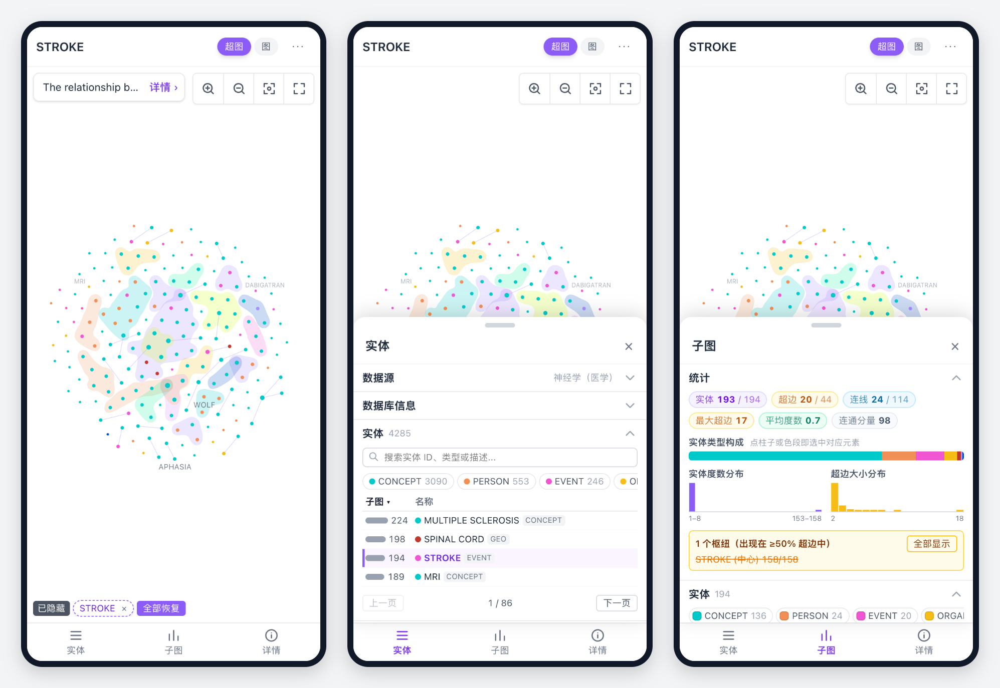

# Hypergraph Viewer - React Version (中文版)

[English](README.md) | 简体中文

让超图看得见，也看得懂。


## 功能特性

- 🕸️ **超图布局**：专为超图设计的力导布局（[hypergraph-viz](packages/hypergraph-viz) 中的 `HypergraphLayout`）:
  - 同一超边的成员聚在一起，非成员被推出超边轮廓；共享成员越多的超边离得越近
  - 选中的实体位于中心，它所在的超边围绕四周排开
  - 3 个及以上成员的超边画成只圈节点（不含标签）的轮廓，2 个成员的超边画成连线
  - 默认隐藏会重叠的标签，悬停、选中时显示；也可以让布局为每个标签留出位置
  - 同样的数据总是得到同样的布局；渲染面板中还可切换力导、ForceAtlas2 和环形布局
- 🧮 **关联矩阵**：一行一个实体、一列一条超边，成员处画点并用超边颜色的竖线连起:
  - 画布上挤成一团的枢纽实体在矩阵里只是满格的一行，每条超边都看得清
  - 行列可按度数排序、按类型分组，或聚类排序让相关的实体与超边聚在一起
  - 可作为整个视图（矩阵模式），也可在右侧栏与画布并排显示，双向联动：悬停、点选行或列即在画布上高亮，反之亦然
  - 滚动时行、列标题固定；悬停卡片与选择和画布一致
- 🔀 **图模式**：3 个及以上成员的超边可丢弃、拆成两两连线，或画成连向各成员的超边节点（二部图）
- 🎨 **交互式界面**:
  - 画布：鼠标悬停显示详细信息，可拖拽图形元素，缩放和平移
  - 左侧面板：数据源、数据库统计、实体与超边列表（支持类型筛选）
  - 右侧面板：当前子图统计、关联矩阵、实体 / 超边表（选择、显隐、改色）、渲染设置（布局、轮廓、节点大小）
  - 面板为可展开收起的卡片
- 🗄️ **Hypergraph-DB 文件**：[Hypergraph-DB](https://github.com/iMoonLab/Hypergraph-DB) 保存的 `.hgdb` 数据库（`hg.save(...)`）可以打开本地文件或用 `?url=` 打开。pickle 在浏览器中解码，不执行任何代码；属性值为 Python 对象（如自定义类）时显示为 `<模块.类名>`
- 🔗 **自己的 HIF 文件**：可加载远程网址或打开本地文件。网址加 `?url=<HIF 文件网址>` 可直接打开远程文件；文件所在服务器需允许跨域请求（GitHub raw 网址可以）。Python `json` 写出的 `NaN` / `Infinity` 按 `null` 读取
- 🔒 **本地渲染**：本地文件在浏览器中读取和渲染，无需上传服务器
- 📱 **手机与平板**：按浏览器自身宽度切换布局（见下方截图）:
  - 电脑（≥ 1200 px）：三栏
  - 平板（768–1199 px）：画布占满宽度，左栏从左侧滑出，右栏浮在画布上
  - 手机（< 768 px）：画布全屏，「实体 / 子图 / 详情」从底部弹出（半屏时仍能看到图，上拉展开）；点实体或超边会高亮并显示信息卡片（同鼠标悬停），双指捏合缩放
- 📝 **详细信息面板**: 实时显示超边和节点的详细属性
- 🎯 **分页浏览**: 高效处理大量数据集
- 📚 **示例数据集**（HIF 格式，在数据源卡片中切换；网址加 `?dataset=<id>` 可直接打开某一套）:
  - 神经学（医学）、英伟达超大规模云（金融）、三国演义、西游记、权力的游戏第一季

### 手机与平板



## 技术栈

- **React 19**: 前端框架
- **Vite**: 构建工具和开发服务器
- **G6 (本地版本)**: 图形可视化库 - 使用本地 g6.min.js 文件
- **Tailwind CSS v4**: 样式框架
- **JavaScript/JSX**: 开发语言

## 安装和运行

### 1. 安装依赖

```bash
# 使用yarn (推荐)
yarn install

# 或使用npm (需要解决权限问题)
npm install
```

### 2. 启动开发服务器

```bash
# 使用yarn
yarn dev

# 或使用npm
npm run dev
```

### 3. 访问应用

打开浏览器访问: http://localhost:5173

## 项目结构

```
packages/hypergraph-viz/        # npm 包
├── src/                        # 布局、轮廓、视图；react.tsx 为 <HypergraphView>
│   ├── explorer/               # hypergraph-viz/explorer：<HypergraphExplorer>、左右面板、数据源、HIF 与 .hgdb 解析
│   └── admin/                  # hypergraph-viz/admin：<HypergraphAdmin> 管理后台（Hypergraph-DB 的 /admin）
src/                            # 本应用：<HypergraphExplorer> 加数据源选择
├── components/
│   └── DataSourceSelector.jsx  # 示例数据集、远程 .hgdb / HIF、本地文件
├── api.js                      # 载入所选数据源
├── datasets.js                 # 示例数据集列表（文件在 public/datasets/，由 scripts/build_datasets.py 生成）
├── i18n.js                     # 本应用的文字；语言记在网址与 localStorage
├── index.css                   # 全局样式
├── App.jsx                     # 应用根组件
└── main.jsx                    # 应用入口点
```

## 数据格式

应用使用的数据格式包括：

- **Database Info**: 数据库基本信息（顶点数、超边数）
- **Vertices**: 顶点数组，包含 ID、类型、度数、描述等
- **Graphs**: 图数据，按顶点 ID 索引，包含相关的顶点和边

## 使用说明

1. **搜索顶点**: 在左侧搜索框中输入关键词
2. **选择顶点**: 点击左侧列表中的任意顶点
3. **切换模式**: 使用顶部的模式切换按钮
4. **查看详情**: 鼠标悬停在图形元素上查看详细信息
5. **交互操作**: 支持拖拽、缩放、平移等操作

## 构建生产版本

```bash
# 构建
yarn build

# 预览构建结果
yarn preview
```

## 本地 G6 集成

该项目使用本地的`g6.min.js`文件而不是 npm 包：

- **G6 文件位置**: `public/g6.min.js`
- **加载方式**: 通过 HTML `<script>` 标签引入
- **使用方式**: 通过`window.G6.Graph`访问

这种方式确保了与原始 HTML 模板完全一致的 G6 版本和功能。

## 开发说明

该项目完全重现了原 HTML 模板的功能，包括：

- 完整的 G6 图形可视化逻辑
- 超边的气泡集合渲染
- 实时搜索和筛选
- 响应式 UI 设计
- 详细的数据展示面板

所有原有的可视化效果、交互功能和数据处理逻辑都得到了完整保留。
