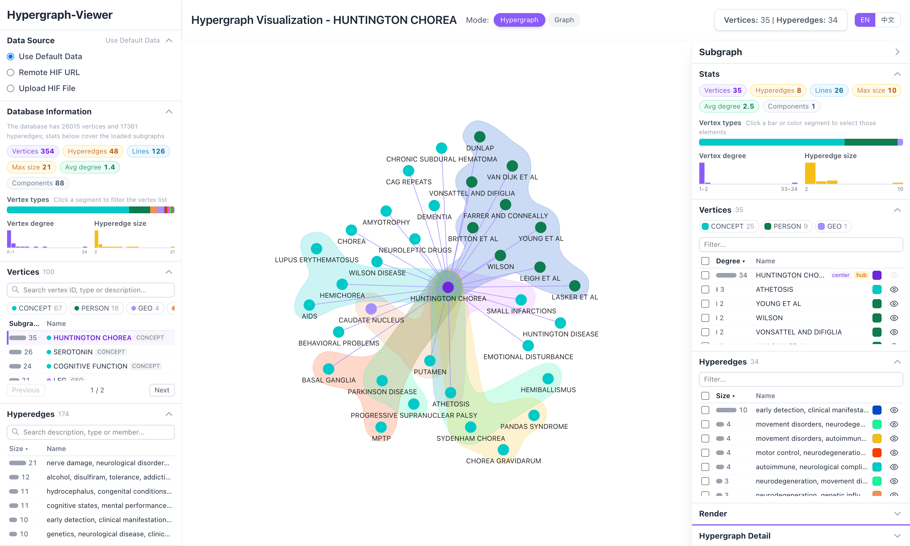

# HypergraphViewer

Make every hypergraph viewable and readable.

DEMO page: https://yuxizhe.github.io/HypergraphViewer/



## Features

- 🕸️ **Hypergraph Layout**: a force-directed layout built for hypergraphs (`HypergraphLayout` in [hypergraph-viz](packages/hypergraph-viz)):
  - Members of a hyperedge stay together, vertices outside it are pushed out of its contour, and hyperedges sharing more members sit closer
  - The selected vertex sits at the center with its hyperedges arranged around it
  - Hyperedges with 3+ members are drawn as contours around their nodes only (labels excluded), 2-member hyperedges as lines
  - Overlapping labels are hidden until hover or selection by default; the layout can also make room for every label
  - The same data always gives the same layout; force, ForceAtlas2 and circular layouts are also available in the Render panel
- 🎨 **Interactive Interface**:
  - Canvas: hover for detailed information, drag graph elements, zoom and pan
  - Left panel: data source, database stats, vertex and hyperedge lists with type filters
  - Right panel: subgraph stats, vertex / hyperedge tables (select, show / hide, recolor), render settings (layout, contours, node size)
  - Panels are collapsible cards
- 🗄️ **Hypergraph-DB files**: `.hgdb` databases saved by [Hypergraph-DB](https://github.com/iMoonLab/Hypergraph-DB) (`hg.save(...)`) can be uploaded or opened with `?url=`. The pickle is decoded in the browser without running any code; values that are Python objects (e.g. custom classes) are shown as `<module.Class>`
- 🔗 **Your own HIF files**: load a remote URL or upload a local file. `?url=<HIF file URL>` opens a remote file directly; the server must allow cross-origin requests (raw GitHub URLs do). `NaN` / `Infinity` values written by Python's `json` are read as `null`
- 📝 **Details Panel**: Real-time display of hyperedge and node properties
- 🎯 **Pagination**: Efficient handling of large datasets
- 📚 **Sample Datasets** (HIF, switch in the data source card; `?dataset=<id>` in the URL selects one):
  - Neurology (medical), NVIDIA hyperscale cloud (finance, Chinese), Romance of the Three Kingdoms, Journey to the West, Game of Thrones season 1

## Screenshots

### Hyper-RAG


## hypergraph-viz (npm package)

[](https://www.npmjs.com/package/hypergraph-viz)

The hypergraph rendering of this project is published as the npm package [`hypergraph-viz`](https://www.npmjs.com/package/hypergraph-viz) (source: [`packages/hypergraph-viz`](packages/hypergraph-viz)). HypergraphViewer, the [Hyper-RAG](https://github.com/iMoonLab/Hyper-RAG) web UI and the [Hypergraph-DB](https://github.com/iMoonLab/Hypergraph-DB) viewer all render with it.

- **Hypergraph layout**: vertices of the same hyperedge stay together, non-members are pushed out of its contour, labels do not overlap
- **Hyperedge contours**: hyperedges with 3+ members are drawn as bubble sets around the nodes only (labels excluded); 2-member hyperedges are drawn as lines
- **Hover and selection**: hover callbacks for nodes, lines and contours; clicking a hyperedge highlights its members and dims the rest
- **Graph mode**: hyperedges as pairwise lines with a force layout
- React component, framework-free API, and a `<script>` build (`window.HypergraphViz`)

```bash
npm install hypergraph-viz @antv/g6@5.0.49
```

```jsx
import { fromKeyedEdges } from 'hypergraph-viz';
import { HypergraphView } from 'hypergraph-viz/react';

// { vertices: { [id]: {...} }, hyperedges: [{ members: [id, ...], ...attrs }] }
const data = {
  vertices: { A: { entity_type: 'PERSON' }, B: {}, C: {}, D: {} },
  hyperedges: [{ members: ['A', 'B', 'C'], keywords: 'team' }, { members: ['C', 'D'] }],
};

<HypergraphView
  style={{ height: 600 }}
  data={data}              // or fromKeyedEdges(graph) for Hyper-RAG / Hypergraph-DB `{ vertices, edges }`
  mode="hyper"             // or 'graph'
  centerNode="A"
  onHover={(hit) => {}}    // { kind: 'node' | 'edge' | 'hyperedge', id, item, client } | null
  onSelect={(hit) => {}}   // hyperedge clicked, null when cleared
/>
```

Without React:

```js
import { createHypergraphView } from 'hypergraph-viz';

const view = createHypergraphView(container, { data, mode: 'hyper', onHover, onSelect });
view.update({ data: next });
view.select(hyperedgeId);
view.destroy();
```

In a plain HTML page, load G6's UMD build first, then the `<script>` build:

```html
<script src="https://unpkg.com/@antv/g6@5.0.49/dist/g6.min.js"></script>
<script src="https://cdn.jsdelivr.net/npm/hypergraph-viz@0.2.0/dist/hypergraph-viz.global.js"></script>
<script>
  const view = HypergraphViz.createHypergraphView(document.getElementById('graph'), { data });
</script>
```

`@antv/g6` (5.0.x) is a peer dependency: the extensions are registered on the host project's G6, so keep a single copy of G6 in the project. See the [package README](packages/hypergraph-viz/README.md) for all options.

## Tech Stack

- **React 19** + **Vite**
- **G6 5.0.49** (npm) with [`hypergraph-viz`](packages/hypergraph-viz) for hypergraph rendering
- **Tailwind CSS v4**

## Installation and Setup

The repository is an npm workspace: the app at the root, the `hypergraph-viz` package under `packages/`.

```bash
npm install
npm run dev     # builds hypergraph-viz first, then starts Vite
```

Open http://localhost:5173

## Project Structure

```
packages/hypergraph-viz/      # npm package
├── src/                      # layout, contours, view; react.tsx: <HypergraphView>
│   ├── explorer/             # hypergraph-viz/explorer: <HypergraphExplorer>, panels, data sources, HIF and .hgdb parsers
│   └── admin/                # hypergraph-viz/admin: <HypergraphAdmin> admin console (Hypergraph-DB's /admin)
public/datasets/              # Sample datasets (HIF), generated by scripts/build_datasets.py
src/                          # This app: <HypergraphExplorer> plus data source selection
├── components/
│   └── DataSourceSelector.jsx  # Sample dataset, .hgdb / HIF URL or file upload
├── api.js                    # Loads the chosen data source
├── datasets.js               # Sample datasets (default centers, hidden types); ?dataset= / ?url=
├── i18n.js                   # App texts; language from URL / localStorage
├── App.jsx
└── main.jsx
```

## Usage Instructions

1. **Choose a data source**: a sample dataset, a HIF file URL, or an uploaded HIF file
2. **Search and select vertices** in the left list
3. **Toggle modes** between hypergraph and graph
4. **Hover** over vertices, lines or contours for details; **click** a hyperedge to highlight it
5. **Interact**: drag, zoom and pan

## Build for Production

```bash
npm run build
npm run preview
```

## Developing hypergraph-viz

```bash
npm run build -w hypergraph-viz   # build ESM / CJS / types / <script> bundle
npm test -w hypergraph-viz        # parity tests against the pre-extraction implementation
```
